# AGENTS.md — Autonomous Agent Knowledge Base & Architecture Guide
## Dual-Mill Steel Mechanical Property Modeling: Heavy Plate & Steckel Mill HRC

> [!IMPORTANT]
> **To Any Future AI Agent Reading This File**:
> This document defines the exact architecture, data contracts, domain metallurgy physics, zero-leakage validation constraints, and execution workflows of this repository. Follow all rules and invariants outlined below without exception.

---

## 1. Repository Identity & High-Level Scope

This repository is an industrial machine learning platform designed to predict room-temperature mechanical tensile properties (**Yield Strength $YS$**, **Tensile Strength $TS$**, **Elongation $EL$**), **Impact Toughness** (Charpy V-Notch at 0 °C, −20 °C, −40 °C), and **Through-Thickness Reduction of Area ($Z$-Test)** from slab chemistry, rolling schedules, and thermal cooling regimes.

The platform is partitioned into two distinct steel rolling product routes:
1. **`Plate\` (Heavy Plate Sequential Rolling)**:
   - **Product**: Thick structural, pressure vessel, and offshore steel plates (gauge $6\text{ mm} - 120\text{ mm}$).
   - **Process**: Reheating furnace $\rightarrow$ Roughing mill $\rightarrow$ Finishing mill $\rightarrow$ Accelerated Cooling (ACC Laminar headers) $\rightarrow$ As-Rolled / TMCP (Before Normalizing) and optional furnace heat treatment (After Normalizing).
   - **Active Dataset**: 23,845 plates extracted from `Plate\raw\PLATE SEQUENTIAL ROLLING RESULT - 2026.xlsx`.
2. **`HRC\` (Steckel Mill Hot Rolled Coil)**:
   - **Product**: Continuous hot-rolled strip coiled into coils (gauge $2.5\text{ mm} - 16\text{ mm}$).
   - **Process**: Reheating furnace $\rightarrow$ Plate/Roughing mill $\rightarrow$ 4-high reversing Steckel Mill (with heated mandrel coiler boxes) $\rightarrow$ Runout Table (ROT) laminar spray cooling $\rightarrow$ Downcoiler.
   - **Active Dataset**: 20,298 coils extracted from `HRC\raw\STECKEL_MILL_REPORT.xlsx`.

Two surfaces sit on top of those pipelines:

- **`app\`** is the operator-facing Streamlit application. It scores a schedule through the mill's own
  feature module, checks it against the GRP specification workbook, inverts the model to propose
  setpoints, and draws response surfaces. It never reimplements feature engineering.
- **`push-to-GH\`** is the deployment mirror pushed to GitHub and Streamlit Community Cloud. It is
  gitignored in this workspace and kept in step by `run_github_sync.bat`.


---

## 2. Inviolable Architectural Invariants

Whenever modifying or extending this codebase, maintain these design constraints:

1. **Root Directory Discipline**:
   - The root holds the batch runners plus a fixed application tree: `app/`, `Plate/`, `HRC/`, `models/`,
     `notebooks/`, `.streamlit/`, `graphify-out/`, `push-to-GH/`, and the top-level `AGENTS.md`,
     `README.md` and `requirements.txt`.
   - Do not drop loose Python scripts, temporary `.joblib` files, or CSVs in the root. Scratch work
     belongs in a subfolder or a temp directory.
2. **Python Code Placement**:
   - Plate Python scripts strictly reside in [`Plate\script\`](file:///C:/16.%20NOTEBOOK%20AND%20ANALYSIS/YS%20TS%20EL%20Train%20and%20Modelling/Plate/script).
   - HRC Python scripts strictly reside in [`HRC\script\`](file:///C:/16.%20NOTEBOOK%20AND%20ANALYSIS/YS%20TS%20EL%20Train%20and%20Modelling/HRC/script).
3. **No Excel COM**:
   - All Excel operations are 100% pure Python using `python-calamine` (Rust-based Excel parser, ~8-14s extraction for 24,000 rows) with fallback to `openpyxl`.
   - Never import `win32com.client`.
4. **Cloud Compute Delegation (Modal Cloud)**:
   - Heavy training, hyperparameter optimization, and 100-iteration bootstrapping must **NEVER run on the local machine**.
   - Cloud execution is handled via `python -m modal run <module>\script\ml\modal_runner.py` (spawning remote Debian containers with 4-8 vCPUs and up to 16 GB RAM).
   - Local fallback is disabled to protect local CPU/RAM.
5. **Zero Data Leakage Group Splitting**:
   - Multiple plates or coils are cut from the same melt heat.
   - **Never use random k-fold or train_test_split**.
   - Always use `GroupShuffleSplit` on `Heat_ID` so all sister plates/coils from the same heat remain exclusively in Train or Validation.
   - Known exception: the in-app refit (`app\streamlit_app.py`, `view_retrain`) falls back to a random row
     split when the uploaded sheet carries 50 or fewer distinct `Heat_ID` values. Treat those R² figures
     as optimistic, and prefer a sheet with real heat identifiers.
6. **Automatic Preflight Data Sync**:
   - Batch files and Python runners verify the modification timestamp of raw Excel files (`raw\*.xlsx`) against cleaned CSVs (`csv\*.csv`).
   - If raw Excel has changed, fast ETL automatically executes to refresh the CSV before cloud upload.
7. **Dual-Directory Workspace & GitHub Subfolder Isolation (`push-to-GH/`)**:
   - The root workspace maintains local batch runners, raw campaign Excels, cleaned datasets, and Modal Cloud scripts.
   - The `push-to-GH/` subfolder is the clean public mirror targeting `https://github.com/daniswaramp/hot-rolling-mechanical-models.git` and Streamlit Community Cloud.
   - Subfolder isolation ensures zero credentials or proprietary campaign sheets leak to GitHub.
   - Run `run_github_sync.bat` to sync artifacts and push cleanly from `push-to-GH/`.
8. **Target Outlier Invariant & Decimal Rescaling**:
   - In `Plate/script/ml/data_prep.py`, `prepare_target_dataset` validates all targets against `PHYSICAL_BOUNDS` and auto-rescales $100\times$ decimal typos ($41,205 \rightarrow 412.05\text{ MPa}$, $28,205 \rightarrow 282.05\text{ MPa}$).
9. **Champion GBDT Default & Model Engine Toggle**:
   - The deployed Streamlit app defaults to native Champion GBDT models (`models/boosted_out/`), providing $<1$ second startup time and peak holdout accuracy ($R^2 = 0.942$ Plate TS, $0.792$ HRC TS).
   - Operators can toggle scoring engines (`[Champion GBDT, CatBoost, XGBoost, LightGBM, Ensemble (.joblib), OLS / Linear]`) directly in the UI.
   - `models/boosted_out/`, `models/linear_families.json` and `models/nlr_models.json` must ship with the
     checkout. When they are missing the selector silently falls back to the joblib ensembles and the
     champion R² drops to a placeholder, so check `models/` before trusting an engine label.
10. **House Limits Come From the Training Envelope**:
   - `app\constraints.py` seeds the permitted entry, exit and cooling bands from
     `models/applicability_domain.json` (P01-P99), not from the mill hardware range.
   - A band may be widened past the trained envelope, but the UI must warn that predictions there are
     extrapolation. Never clamp silently. Entries in the domain file that are unusable (a laminar header
     range of 671-1469, coiling temperatures with a P01 of zero) fall back to the mill envelope and the
     row says which source it used.
11. **No Raw Heats in the Public Mirror**:
   - The cleaned CSVs stay out of `push-to-GH/`. The sidebar statistics read `models/training_stats.json`,
     a compact summary regenerated by `app\build_stats_bundle.py` from both cleaned tables.
   - Re-run that script whenever the cleaned CSVs change, and commit the refreshed bundle, or the deployed
     app shows stale figures.
12. **Impact Compliance Coverage**:
   - `spec_checker.py` evaluates Charpy at 0 °C, -20 °C and -40 °C only. The GRP workbook carries 18 impact
     columns; 156 of its 1,494 rows state a limit in a column the checker does not read. Extend the
     `impact_map` table before claiming a specification is fully covered.

---

## 3. System Architecture & Knowledge Graph

### 3.1 Application modules (`app\`)

| Module | Responsibility |
| --- | --- |
| `streamlit_app.py` | Every view: simulator, specification check, inverse optimizer tab, response surface (1D slice / 2D contour / 3D surface), capability, batch upload, refit, diagnostics. Also the scoring layer (`score_frame`, `predict_champion`, `predict_selected_engine`). |
| `model_loader.py` | Loads the per-target joblib bundles, reads the conformal and bootstrap reports, computes the physical indicators, and applies the plate normalising coupling. |
| `spec_checker.py` | Reads `specification-list\SPECIFICATION LIST.xlsx`, matches a spec/grade/thickness tier, and evaluates gauge, chemistry and mechanical compliance. |
| `optimizer.py` | Inverse setpoint solver. Sweeps a discretised schedule inside the permitted window, keeps candidates that clear the spec at the 95 % conformal bound, and ranks the survivors with one or more objectives. |
| `constraints.py` | Permitted temperature window (seeded from the trained P01-P99 envelope) plus the CE_IIW and P_cm caps. Shared by the optimizer and the surface. |
| `training_stats.py` | Sidebar statistics. Reads the cleaned CSV when it is on disk and `models\training_stats.json` when it is not. |
| `build_stats_bundle.py` | Regenerates that bundle from both cleaned tables. Run it after any ETL refresh. |
| `explainer.py` | TreeSHAP attribution and the applicability-domain (P01-P99) monitor. |
| `views\` | Superseded copies of the simulator and optimizer. Nothing imports them; do not extend them. |

The inverse optimizer exposes these objectives, filtered per route: minimum CE_IIW, minimum P_cm,
minimum alloy cost, maximum safety margin, minimum TS overshoot, maximise finish temperature,
maximise entry temperature, maximise post-laminar temperature (plate), maximise coiling temperature
(coil). Several can be selected at once; each is normalised across the compliant set and averaged.

The Mermaid chart below visualizes the entire system topology, from raw Excel ingestion to cloud training and local report delivery:

```mermaid
flowchart TD
    subgraph Root["Project Root (.bat Runners)"]
        BAT_P_TRAIN["run_plate_train.bat"]
        BAT_P_TUNE["run_plate_tune.bat"]
        BAT_P_ETL["run_plate_etl.bat"]
        BAT_H_TRAIN["run_hrc_train.bat"]
        BAT_H_TUNE["run_hrc_tune.bat"]
        BAT_H_ETL["run_hrc_etl.bat"]
    end

    subgraph Plate_Pipeline["Plate Subsystem (Plate/)"]
        P_RAW["Plate/raw/*.xlsx<br>(23,845 records)"]
        P_SCHEMA["Plate/script/column_schema.py<br>(84 columns)"]
        P_ETL["Plate/script/extract_rolling_data.py"]
        P_CSV["Plate/csv/plate_rolling_2026_cleaned.csv"]
        P_PREP["Plate/script/ml/data_prep.py<br>(Decimal shift fix & GroupSplit)"]
        P_FEAT["Plate/script/ml/features.py<br>(Hall-Petch, Pickering, Ar3)"]
        P_MODELS["Plate/script/ml/models.py<br>(OLS, NLR, Ridge, GBDT)"]
        P_EVAL["Plate/script/ml/evaluate.py"]
        P_MODAL["Plate/script/ml/modal_runner.py"]
    end

    subgraph HRC_Pipeline["HRC Subsystem (HRC/)"]
        H_RAW["HRC/raw/*.xlsx<br>(20,298 records)"]
        H_SCHEMA["HRC/script/column_schema.py<br>(35 columns)"]
        H_ETL["HRC/script/extract_steckel_data.py"]
        H_CSV["HRC/csv/steckel_mill_cleaned.csv"]
        H_PREP["HRC/script/ml/data_prep.py<br>(Decimal shift fix & GroupSplit)"]
        H_FEAT["HRC/script/ml/features.py<br>(Steckel strain, ROT CR, Pickering)"]
        H_MODELS["HRC/script/ml/models.py<br>(OLS, NLR, Ridge, GBDT)"]
        H_EVAL["HRC/script/ml/evaluate.py"]
        H_MODAL["HRC/script/ml/modal_runner.py"]
    end

    subgraph Modal_Cloud["Modal Serverless Cloud (Debian Container)"]
        CLOUD_EXEC["Multi-Model Training & Tuning<br>4-8 vCPUs / 16GB RAM"]
        BASE_TRAIN["train_baseline.py<br>(6 Model Families)"]
        TUNE_BOOT["tune_bootstrap.py<br>(Stacking & 100-Iter Bootstrap)"]
        NB_GEN["notebook_generator.py<br>(Automated Jupyter Rendering)"]
    end

    subgraph Artifacts["Downloaded Artifacts"]
        MODELS_OUT["models/*.joblib<br>(Best & Tuned Ensembles)"]
        REPORTS_OUT["reports/*.csv & formulas.txt<br>(Leaderboards & 95% CIs)"]
        NB_OUT["notebooks/*.ipynb<br>(Executed Visual Analytics)"]
    end

    %% Trigger connections
    BAT_P_TRAIN --> P_ETL --> P_MODAL
    BAT_P_TUNE --> P_ETL --> P_MODAL
    BAT_P_ETL --> P_ETL
    BAT_H_TRAIN --> H_ETL --> H_MODAL
    BAT_H_TUNE --> H_ETL --> H_MODAL
    BAT_H_ETL --> H_ETL

    %% ETL Flow
    P_RAW --> P_ETL
    P_SCHEMA -.-> P_ETL
    P_ETL --> P_CSV --> P_MODAL

    H_RAW --> H_ETL
    H_SCHEMA -.-> H_ETL
    H_ETL --> H_CSV --> H_MODAL

    %% Cloud dispatch
    P_MODAL ==> CLOUD_EXEC
    H_MODAL ==> CLOUD_EXEC

    CLOUD_EXEC --> BASE_TRAIN
    CLOUD_EXEC --> TUNE_BOOT
    CLOUD_EXEC --> NB_GEN

    %% Outputs
    CLOUD_EXEC ==> MODELS_OUT
    CLOUD_EXEC ==> REPORTS_OUT
    CLOUD_EXEC ==> NB_OUT

    subgraph Operator_App["Streamlit App (app/)"]
        APP_MAIN["streamlit_app.py<br>views + scoring layer"]
        APP_FEAT["model_loader.py<br>mill feature module, joblib bundles"]
        APP_SPEC["spec_checker.py<br>GRP specification workbook"]
        APP_OPT["optimizer.py<br>inverse setpoints, objectives"]
        APP_LIM["constraints.py<br>trained window + CE/Pcm caps"]
        APP_STATS["training_stats.py<br>sidebar distributions"]
    end

    subgraph App_Data["Artefacts the app reads"]
        SPECBOOK["specification-list/<br>SPECIFICATION LIST.xlsx"]
        DOMAIN["models/applicability_domain.json<br>(P01-P99)"]
        STATSJSON["models/training_stats.json<br>(built from the cleaned CSVs)"]
    end

    APP_MAIN --> APP_FEAT --> MODELS_OUT
    APP_MAIN --> APP_SPEC --> SPECBOOK
    APP_MAIN --> APP_OPT --> APP_LIM --> DOMAIN
    APP_MAIN --> APP_STATS
    APP_STATS --> STATSJSON
    P_CSV -.-> STATSJSON
    H_CSV -.-> STATSJSON
    MODELS_OUT ==> APP_FEAT
```



---

## 4. Metallurgy Domain Physics & Feature Engineering

Both pipelines integrate physical metallurgical principles into machine learning feature matrices:

### 4.1 Pickering Solid Solution Strengthening ($\sigma_{ss}$)
Solid solution elements distort the ferrite lattice, impeding dislocation glide:
$$\sigma_{ss}\text{ (MPa)} = 32 [\%Mn] + 84 [\%Si] + 43 [\%Ni] - 30 [\%Cr] + 38 [\%Cu] + 80 [\%Ti] + 11 [\%Mo] + 354 [\%N]$$

### 4.2 Hall-Petch Grain Size Proxy ($d_\alpha^{-1/2}$)
Grain boundaries act as strong obstacles to dislocation movement ($YS = \sigma_0 + k_y d_\alpha^{-1/2}$):
- For Heavy Plate: $1 / \sqrt{Plate\_T\_mm}$ and cooling rate proxy $CR = \frac{FRT - Post\_Laminar\_Temp}{Plate\_T\_mm}$.
- For Steckel Mill HRC: $1 / \sqrt{Coil\_T\_mm}$ and ROT cooling rate $CR_{ROT} = \frac{FT - CT_{\text{avg}}}{Coil\_T\_mm}$.

### 4.3 True Deformation Strain ($\varepsilon$)
Logarithmic true strain accumulated across reduction passes:
- **Plate**: $\varepsilon_{\text{total}} = \ln\left(\frac{Slab\_T}{Plate\_T}\right)$, $\varepsilon_{FM} = \ln\left(\frac{TB\_Thick}{Plate\_T}\right)$, and $\varepsilon_{\text{last}} = \ln\left(\frac{h_{n-1}}{Plate\_T}\right)$.
- **HRC**: $\varepsilon_{STM} = \ln\left(\frac{TB\_Thick}{Coil\_T}\right)$ and reduction draft ratio $R = \frac{TB\_Thick - Coil\_T}{TB\_Thick}$.

### 4.4 Phase Transformation Boundaries ($Ar_3$, $Ar_1$)
Governs whether final drafting occurs in the unrecrystallized austenite, intercritical $(\gamma + \alpha)$, or ferrite phase:
$$Ar_3\ (^\circ\text{C}) = 910 - 310 [\%C] - 80 [\%Mn] - 20 [\%Cu] - 15 [\%Cr] - 55 [\%Ni] - 80 [\%Mo]$$
$$Ar_1\ (^\circ\text{C}) = 723 - 10.7 [\%Mn] - 16.9 [\%Ni] + 29.1 [\%Si] + 16.9 [\%Cr]$$
Features computed: $(FRT - Ar_3)$, $(CT - Ar_1)$, and supercooling $\Delta T_{\text{sub}} = \max(0, Ar_3 - FRT)$.

### 4.5 Carbon Equivalents & Weldability
- $CE_{IIW} = [\%C] + \frac{[\%Mn]}{6} + \frac{[\%Cr]+[\%Mo]+[\%V]}{5} + \frac{[\%Ni]+[\%Cu]}{15}$
- $P_{cm} = [\%C] + \frac{[\%Si]}{30} + \frac{[\%Mn]+[\%Cu]+[\%Cr]}{20} + \frac{[\%Ni]}{60} + \frac{[\%Mo]}{15} + \frac{[\%V]}{10} + 5[\%B]$

---

## 5. Machine Learning Models & Ensembling Strategy

Each target property is evaluated against **six fitted model families**, then two validation layers:

1. **Ordinary Least Squares (OLS)** *(Whitebox)*:
   Linear regression with median imputation and standardized z-score scaling. Produces verifiable linear coefficients.
2. **Non-Linear Metallurgical Constitutive Fit (NLR)** *(Whitebox)*:
   Fits physics parameters via Levenberg-Marquardt / Trust Region Reflective `scipy.optimize.curve_fit`:
   $$YS = \sigma_0 + k_{ss} \cdot \sigma_{ss} + k_{hp} \cdot \frac{1}{\sqrt{t}} + k_\varepsilon \cdot \varepsilon^n - k_T \cdot (T_{\text{cool}} - 500)$$
3. **Ridge Regression** *(Whitebox)*:
   Regularized L2 linear model with cross-validated penalty parameter $\alpha$.
4. **XGBoost Regressor**:
   Gradient boosted trees with histogram-based split finding and column subsampling.
5. **LightGBM Regressor**:
   Fast leaf-wise tree growth with categorical feature handling.
6. **CatBoost Regressor**:
   Symmetric tree structure with ordered boosting to resist overfitting.
7. **Stacking Meta-Learner (Ensemble)**:
   A meta-learner (RidgeCV) that blends out-of-fold predictions from Ridge, XGBoost, LightGBM, and CatBoost.
8. **100-Iteration Heat-Level Bootstrapping**:
   Resamples test heats with replacement to produce empirical 95% Confidence Intervals for $R^2$ and RMSE.

---

## 6. Empirical Performance Reference

### Plate Pipeline (`Plate\`) — Evaluated on 353 Held-Out Heats
- **TS Before Normalizing (`TS_BN`)**: $R^2 = \mathbf{0.9435}$, $\text{RMSE} = \mathbf{13.50\text{ MPa}}$, $\pm 20$ MPa Hit Rate = **89.6%**, 95% CI: $[0.9323,\; 0.9410]$.
- **YS Before Normalizing (`YS_BN`)**: $R^2 = \mathbf{0.9204}$, $\text{RMSE} = \mathbf{16.97\text{ MPa}}$, $\pm 20$ MPa Hit Rate = **81.5%**, 95% CI: $[0.9104,\; 0.9172]$.
- **EL Before Normalizing (`EL_BN`)**: $R^2 = \mathbf{0.6628}$, $\text{RMSE} = 2.10\%$, Hit Rate = 100.0%.
- **TS After Normalizing (`TS_AN`)**: $R^2 = \mathbf{0.6331}$, $\text{RMSE} = 16.36\text{ MPa}$, Hit Rate = **79.6%**.
- **Z-Test Reduction of Area**: $R^2 = \mathbf{0.6169}$, $\text{RMSE} = 4.41\%$, Hit Rate = 98.8%.

### HRC Steckel Pipeline (`HRC\`) — Evaluated on 919 Held-Out Heats (Pure Metallurgy, No Specification Bias)
> [!NOTE]
> Specification names/codes are intentionally omitted from features. In physical metallurgy, properties are governed strictly by chemical composition and thermomechanical rolling history, not commercial specification labels. This ensures zero label leakage and maximum generalization to unclassified or custom steel grades.

- **Tensile Strength (`TS_BN`)**: $R^2 = \mathbf{0.7954}$, $\text{RMSE} = \mathbf{18.73\text{ MPa}}$, $\pm 20$ MPa Hit Rate = **76.6%**, 95% CI: $[0.7673,\; 0.8161]$.
- **Yield Strength (`YS_BN`)**: $R^2 = \mathbf{0.6146}$, $\text{RMSE} = \mathbf{26.86\text{ MPa}}$, $\pm 20$ MPa Hit Rate = **60.7%**, 95% CI: $[0.5825,\; 0.6367]$.
- **Elongation (`EL_BN`)**: $R^2 = \mathbf{0.6356}$, $\text{RMSE} = \mathbf{2.73\%}$, $\pm 2.5\%$ Hit Rate = **65.4%**, 95% CI: $[0.6087,\; 0.6582]$.

---

## 7. Operational Run Guide (For Future Agents)

### Running Pipelines via Batch Runners
Trigger from command line or automated agent subprocess:
```cmd
:: Plate Pipeline
run_plate_etl.bat     :: Force standalone extraction of Plate Excel to CSV
run_plate_train.bat   :: Train baseline models on Modal Cloud
run_plate_tune.bat    :: Hyperparameter tuning & 100-iter bootstrap on Modal Cloud

:: HRC Steckel Pipeline
run_hrc_etl.bat       :: Force standalone extraction of Steckel Excel to CSV
run_hrc_train.bat     :: Train baseline models on Modal Cloud
run_hrc_tune.bat      :: Hyperparameter tuning & 100-iter bootstrap on Modal Cloud
```

### Running Directly via Python & Modal
Ensure environment variables are set on Windows:
```powershell
$env:PYTHONIOENCODING="utf-8"
$env:PYTHONUTF8="1"

# Plate cloud execution
python -m modal run Plate\script\ml\modal_runner.py --action baseline
python -m modal run Plate\script\ml\modal_runner.py --action tune

# HRC cloud execution
python -m modal run HRC\script\ml\modal_runner.py --action baseline
python -m modal run HRC\script\ml\modal_runner.py --action tune
```

---

## 8. Graphify Knowledge Graph & MCP Agent Traversal

The complete structural AST and community graph of this codebase is maintained in **[`graphify-out\`](file:///C:/16.%20NOTEBOOK%20AND%20ANALYSIS/YS%20TS%20EL%20Train%20and%20Modelling/graphify-out)**:
- **Interactive Visual Graph**: [`graphify-out\graph.html`](file:///C:/16.%20NOTEBOOK%20AND%20ANALYSIS/YS%20TS%20EL%20Train%20and%20Modelling/graphify-out/graph.html) (open in any browser to explore node connections).
- **GraphRAG JSON Schema**: [`graphify-out\graph.json`](file:///C:/16.%20NOTEBOOK%20AND%20ANALYSIS/YS%20TS%20EL%20Train%20and%20Modelling/graphify-out/graph.json) (369 nodes, 608 edges, 18 community clusters).
- **Vector Graph Export**: [`graphify-out\graph.svg`](file:///C:/16.%20NOTEBOOK%20AND%20ANALYSIS/YS%20TS%20EL%20Train%20and%20Modelling/graphify-out/graph.svg).
- **Detailed Graph Report**: [`graphify-out\GRAPH_REPORT.md`](file:///C:/16.%20NOTEBOOK%20AND%20ANALYSIS/YS%20TS%20EL%20Train%20and%20Modelling/graphify-out/GRAPH_REPORT.md).

Scope of the current graph: `app\` plus the `Plate\` and `HRC\` scripts. `push-to-GH\` is excluded, because it
is a mirror of the same files and would double every node. The app half is AST-only, so it carries symbols and
calls but no rationale nodes; add those with `/graphify app --mode deep` if the commentary matters.

Regenerate after code changes with the AST path (no LLM, no cost):

```bash
python -c "from pathlib import Path; from graphify.extract import extract; \
import json; r=extract(sorted(Path('app').rglob('*.py')), cache_root=Path('.')); \
json.dump(r, open('graphify-out/.graphify_ast.json','w'))"
```

Then merge the new nodes into `.graphify_extract.json` and rebuild `graph.json`, `graph.html`, `graph.svg` and
`GRAPH_REPORT.md` from it.

### Live MCP Server for Other Agents
Any LLM or external agent can query this knowledge graph live via the standard Model Context Protocol (MCP):
```bash
python -m graphify.serve graphify-out/graph.json
```
Exposed tools include `query_graph`, `get_node`, `get_neighbors`, `get_community`, `god_nodes`, `graph_stats`, and `shortest_path`.
